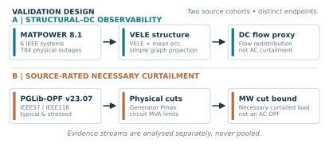
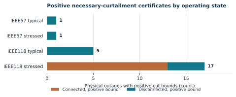
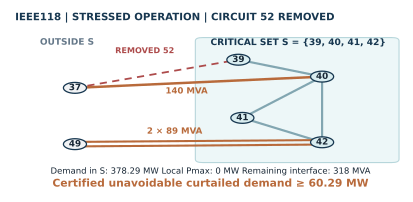
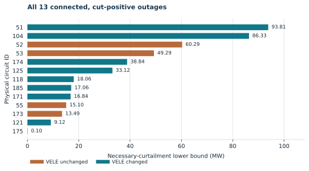

# Version 2 — Visual evidence atlas

The following four figures are **source-traceable visual explanations**, not additional experiments or new estimates. They accompany the narrower electrical-observability paper in preparation. This atlas is a **post-v2.0.0 presentation update on `main`**; it does not modify the immutable [v2.0.0 source/data release](https://github.com/SunilgarGusai/VELE-PowerGrid-Reproducibility/releases/tag/v2.0.0).

All images are vector SVG with readable labels. Use the linked standalone graphic for full-size inspection and accessible text, rather than relying on a compressed screenshot.

## 1. Two distinct source and endpoint cohorts



The MATPOWER 8.1 historical evidence and PGLib-OPF v23.07 source-rated evidence use **different input cases and different electrical endpoints**. No pooled comparisons are supported. The original MATPOWER cohort contains six IEEE systems with 784 physical single-branch outages. The PGLib cohort contains IEEE57 and IEEE118 under two operating conditions each (not four independent networks).

## 2. Certifiable curtailment lower bounds by operating condition



Source-rated physical cut certificates count **13 positive connected** and **4 positive disconnected** stressed IEEE118 outages; IEEE118 typical has **5 positive disconnected** outages, and IEEE57 typical and stressed have **1 positive disconnected** outage each. **Zero certified bound is inconclusive**, never an AC-security negative label.

## 3. A concrete connected, zero-VELE electrical counterexample



For PGLib IEEE118 stressed **physical circuit ID 52** (37–39, 151 MVA), the surviving critical-set interface has one 37–40 circuit rated **140 MVA** and two separately rated 42–49 circuits of **89 MVA each**. Thus `C(S)=318 MVA`; local maximum generation is **0 MW** and positive demand is **378.29 MW**, implying a conservative necessary curtailed-demand lower bound of **60.29 MW**. The graph's unweighted VELE does not change. The removed 37–39 circuit is dashed red and is **not** included in surviving transfer capacity.

## 4. All 13 source-rated, connected positive cut certificates



The orange bars indicate the **four VELE-invisible** but positively certified outages: circuit **52 (60.29 MW)**, **53 (49.29 MW)**, **55 (15.10 MW)** and **173 (13.49 MW)**. All thirteen bounds were independently reconstructed using two network-flow algorithms. Other zeros are *not* certified safe, and this chart does **not** constitute an AC-security ROC-AUC evaluation.

## Regeneration

After installing the [certified-cut dependencies](../certified_cut_v2/requirements.txt) and Matplotlib, run from the repository root:

```bash
python certified_cut_v2/fetch_pglib_v23_07_sources.py
python scripts/generate_v2_scientific_figures.py
```

The generator asserts source identifiers, physical remaining-cut circuits, thirteen certificate counts, the four VELE-invisible IDs and the four-condition census before writing SVG/PDF/340-DPI PNG assets. Its **source inputs** are the pinned PGLib v23.07 case SHA-256 manifest and the archived certificate and cohort-summary CSVs in `certified_cut_v2/`. The generated chart itself is explanatory: the AC OPF problem is not solved by drawing the chart.

**Rights and provenance:** source PGLib benchmark data retain the upstream Creative Commons Attribution 4.0 attribution; software remains under its own license. Do not reproduce the unpublished manuscript or editor-facing cover-letter files in this public gallery.
